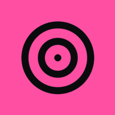
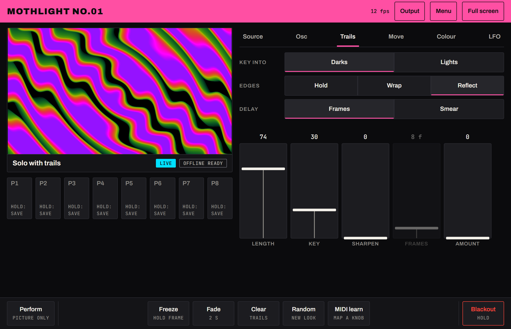
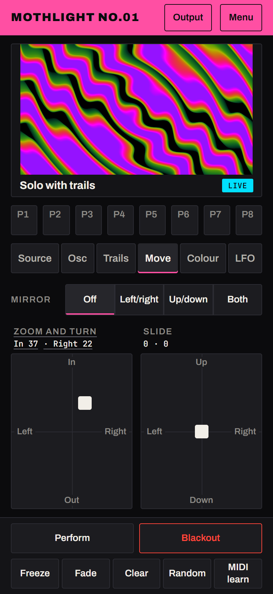
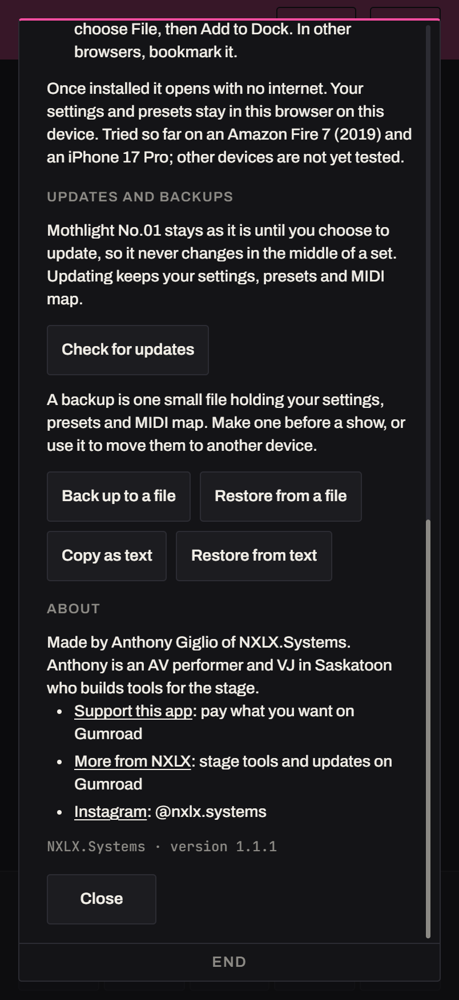

  

<h1 align="center">Mothlight No.01</h1>

  <b>A live video synth for VJ sets. Patterns, feedback trails and colour, drawn by your phone, tablet or computer. Free, offline, no account.</b>

  <a href="https://nxlx-systems.github.io/nxlx-mothlight-01/"><b>Open the synth</b></a>
  &nbsp;·&nbsp;
  <a href="#install-it">Install it</a>
  &nbsp;·&nbsp;
  <a href="https://nxlx.gumroad.com/l/mothlight-no-01">Get it on Gumroad (pay what you want)</a>

  

  
  &nbsp;
  

---

## What it does

| Feature | What it does |
|---|---|
| **Two pattern engines** | Solo (two oscillators, one bending the other) or Duo (two full oscillators and a mix). Or use your camera as the source. |
| **Feedback trails** | Length, key, sharpen and edges, plus Frames (the trails fed from a frame up to 60 frames back) or Smear (a long exposure), so patterns trail, repeat and grow. |
| **Move** | Mirror, zoom, turn and slide, all working on the trails as they build. |
| **Colour, last** | Colour is decided after the feedback, so any pattern, the camera or the trails can wear any colour. |
| **Two LFOs** | Slow movers you can send to zoom, turn, bend, angle, hue or key, so the picture keeps moving on its own. |
| **Made to perform** | Perform (picture only), Freeze, Fade, Clear, Random, eight presets, and Blackout on a hold. Tap the number above a fader to put it back. |
| **MIDI learn** | Map a knob to any control in a few taps, in browsers with Web MIDI. |
| **Works offline** | Install it once and it opens with no internet. It updates only when you tap Update now, so it never changes in the middle of a set. |
| **Backups** | Save your settings, presets and MIDI map to one small file, and restore them on any device. |
| **Private** | Everything stays on your device. No account, no tracking, no ads. |

## Install it

It runs in any up-to-date web browser with WebGL 2. Installing it adds an icon and lets it work with no internet.

**iPhone or iPad**
1. Open **[the synth](https://nxlx-systems.github.io/nxlx-mothlight-01/)** in **Safari**.
2. Tap **Share**, then **Add to Home Screen**.

**Android phones and tablets, Fire included**
1. Open the synth in your browser.
2. Open the browser's menu, then **Install app** or **Add to Home screen**.

**Computer**
- **Chrome or Edge:** use the install button in the address bar.
- **Safari on a Mac:** choose **File**, then **Add to Dock**.
- Any other browser: bookmark it.

## How it works: the ideas behind it

**One straight signal path.** The tabs run left to right in the order the picture flows:

- **Osc:** the oscillator makes a pattern in brightness only.
- **Trails:** feeds the picture back into itself.
- **Move:** folds, zooms and slides the feedback.
- **Colour:** decides the colours once, near the end.
- **LFO:** the two LFOs reach back into every stage.

**Ideas borrowed from the instruments we love.** The oscillators, keying and modulation follow the spirit of video synths like Lumen and Vsynth. The feedback stage takes the idea behind processors like VSERPI and Waaave Pool: a picture fed back with zoom, turn and shift, plus frames from the past. Those instruments are other people's work, named here only as inspiration; Mothlight No.01 is not connected with them.

**Open shader files.** Each stage is an ISF shader, a format many VJ tools read. The four files are in [`isf/`](isf/). They have not yet been tried in other ISF software, and Frames and Smear only work inside Mothlight No.01.

**Why the name.** Moths are drawn to a projector beam the way a crowd is drawn to a good show. It is also a nod to Stan Brakhage's 1963 film *Mothlight*, made by pressing moth wings and leaves straight onto film. No.01 is a model number, like hardware.

## Tried on

- **iPhone 17 Pro**, version 0.5.3: opens and plays in Safari and from its home screen icon, also in Airplane mode.
- **Amazon Fire 7 (2019)** in its Silk browser, version 0.5.7: opens and plays, held sideways, at 60 frames a second by the app's own counter. Version 1.1.1 passed the touch, option and system tests on the same Fire, run inside our Android test app (the same web app in Android's own browser engine).
- **Everything else:** not yet tested. If it runs on yours, or does not, tell us.
- **MIDI** needs Web MIDI: Chrome or Edge on a computer, or Chrome on Android. Safari does not have it.

## Light safety

Mothlight No.01 makes moving and changing light patterns, and some settings can flicker. If you or anyone watching has photosensitive epilepsy, or a pattern makes you feel unwell, stop and look away. Hold Blackout to stop the picture.

## About this repository

This repository holds only the built app, served by GitHub Pages at [nxlx-systems.github.io/nxlx-mothlight-01](https://nxlx-systems.github.io/nxlx-mothlight-01/). The source is kept separately.

## Licence

- **The app:** PolyForm Noncommercial 1.0.0, with permission to perform with it at paid shows, gigs and events. Selling the app itself, or bundling it into something you sell, needs written permission.
- **The shaders** in `isf/`: Apache 2.0.
- **The fonts:** SIL Open Font License 1.1.

See [LICENSE.txt](LICENSE.txt) and [`licences/`](licences/). Copyright 2026 NXLX.Systems.

---

  Made by Anthony Giglio of NXLX.Systems, Saskatoon. 
  <a href="https://nxlx.gumroad.com">More from NXLX</a>
  &nbsp;·&nbsp;
  <a href="https://instagram.com/nxlx.systems">Instagram</a>

